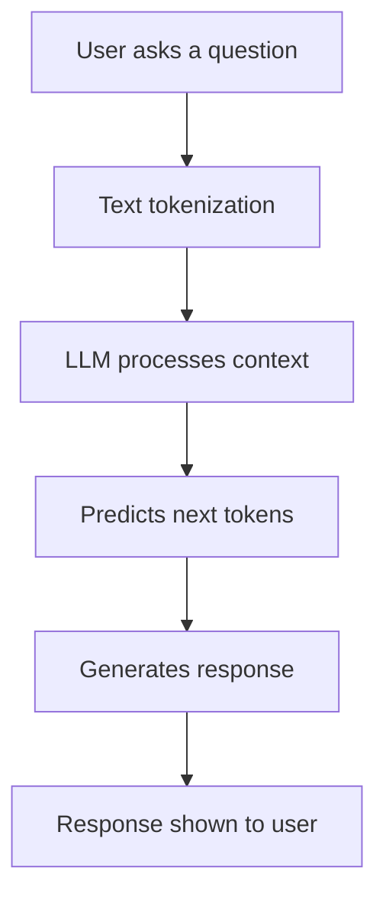

# How Large Language Models (LLMs) Work

## 1. What is an LLM?

A Large Language Model (LLM) is an artificial intelligence model trained on large amounts of text. It learns patterns in language so that it can understand questions and generate useful responses.

Examples of LLMs include ChatGPT, Gemini and Llama.

## 2. How does an LLM work?

An LLM works through the following steps:

1. **User input:** A person enters a question or instruction.
2. **Tokenization:** The text is divided into smaller units called tokens.
3. **Processing:** The model analyses relationships and patterns between tokens.
4. **Prediction:** It predicts the next likely token based on the context.
5. **Response generation:** It generates tokens one after another to create a response.
6. **Output:** The generated response is displayed to the user.

## 3. Diagram of LLM working

## 4. How LLMs can help JalSanchay

JalSanchay provides information about rooftop rainwater harvesting and artificial groundwater recharge using CGWB manuals.

An LLM can help users:
- Understand technical terms in simple language.
- Explain rainwater harvesting methods.
- Summarize information from technical documents.
- Convert technical information into understandable answers.
- Help users formulate questions about water conservation.

## 5. LLMs and JalSanchay data

An LLM does not automatically know the contents of our local JalSanchay dataset.

Our application can search its stored CGWB records and retrieve relevant information. An LLM can then use that retrieved information to explain the answer in natural language.

This approach is commonly called Retrieval-Augmented Generation (RAG).

## 6. Limitations

- An LLM can generate incorrect or misleading information.
- It may not know current groundwater levels or local measurements.
- Its answers should be checked against reliable sources.
- It should not invent technical values when the available data does not contain them.

## 7. Conclusion

LLMs make it easier for people to interact with technical information using natural language. In JalSanchay, they can help users understand CGWB information and make rainwater harvesting knowledge more accessible. Reliable answers still depend on accurate source data.

## 8. Real JalSanchay User Questions

These are practical questions that users may ask when planning rooftop rainwater harvesting and groundwater recharge.

1. How much rainwater can a rooftop collect?
2. What is the purpose of a first-flush system?
3. How do I estimate rainwater storage capacity?
4. Which roofing materials are suitable for rainwater harvesting?
5. What size of downpipe should I use for rooftop rainwater collection?
6. What is the current groundwater level at my exact plot in Kopargaon?
7. What type of filter is used in a rooftop rainwater harvesting system?
8. How many litres of water should be stored per person during water scarcity?
9. What is the purpose of gutters in a rooftop rainwater harvesting system?
10. Which artificial groundwater recharge method is suitable for my area?

### Question the current dataset cannot answer

**Q6:** What is the current groundwater level at my exact plot in Kopargaon?

Our current dataset contains general technical information from CGWB manuals. It does not contain live groundwater-level measurements or plot-specific data. Therefore, the application cannot provide a verified answer to this question.
