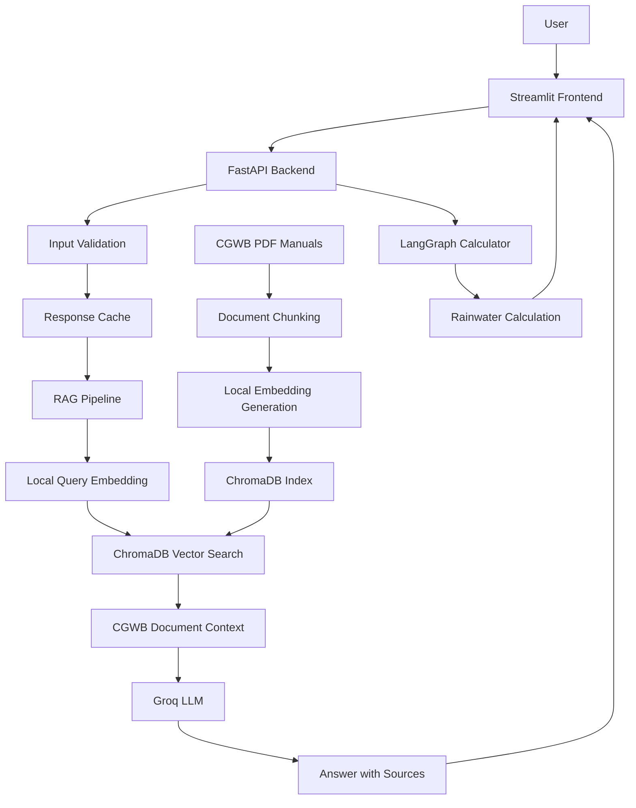

# JalSanchay – AI-Powered Rainwater Harvesting Assistant

## Live Project

**Try JalSanchay:** [Open Live Application](https://jalsanchay-ui.onrender.com)

- **Frontend:** https://jalsanchay-ui.onrender.com
- **Backend API:** https://ai-traning-ojdc.onrender.com
- **API Health:** https://ai-traning-ojdc.onrender.com/health
- **API Documentation:** https://ai-traning-ojdc.onrender.com/docs

## 1. Project Overview

**JalSanchay** is an AI-powered rainwater harvesting and groundwater recharge assistant that helps users understand, evaluate, and plan suitable water conservation systems using technical guidelines from the Central Ground Water Board (CGWB).

### Problem Statement

Planning rooftop rainwater harvesting and groundwater recharge systems requires technical knowledge of rainfall, roof characteristics, storage requirements, recharge methods, and groundwater conditions.

Students, civil engineering professionals, and communities may find it difficult to interpret technical manuals and apply their guidelines to practical projects.

### Solution

JalSanchay combines Retrieval-Augmented Generation (RAG), an AI question-answering system, and a rainwater harvesting calculator to make technical water conservation information easier to access and apply.

**Primary use case:** Supporting a civil engineering student in evaluating rainwater harvesting and groundwater recharge solutions for a college hostel and a family bungalow in Kopargaon, Maharashtra.

## 2. Key Features

- **AI Knowledge Assistant:** Ask questions about rainwater harvesting and groundwater recharge.
- **Document-Based Answers:** Retrieves information from official CGWB manuals.
- **Source Citations:** Provides supporting document references with answers.
- **Abstention:** Avoids inventing answers when reliable supporting information is unavailable.
- **Rainwater Calculator:** Estimates rooftop rainwater harvesting potential.
- **LangGraph Agent:** Supports the calculator workflow with an approval step.
- **Design Sheet:** Generates a design summary and PDF.
- **Feedback Collection:** Allows users to provide feedback.
- **Request Caching:** Reduces repeated processing for identical questions.

## 3. Technology Stack

| Component | Technology |
|---|---|
| Frontend | Streamlit |
| Backend | FastAPI |
| Answer generation | Groq – `openai/gpt-oss-120b` |
| Primary document source | CGWB manuals |
| Vector database | ChromaDB |
| Active embeddings | Local scikit-learn HashingVectorizer |
| Preserved embedding index | Google Gemini |
| Agent workflow | LangGraph |
| Data processing | Python |
| Testing | Pytest |
| Code quality | Ruff |
| Containerization | Docker |
| CI/CD | GitHub Actions |
| Deployment | Render |

## 4. System Architecture

## 5. RAG Evaluation Results

Two RAG configurations were evaluated using a 15-question evaluation dataset.

| Configuration | Chunk Size | Overlap | Top-k | Keyword Coverage | Q6 Abstention |
|---|---:|---:|---:|---:|---|
| A | 1200 | 200 | 3 | 80.95% | Pass |
| B | 800 | 100 | 5 | **83.33%** | Pass |

### Winning Configuration

Configuration B was selected because it achieved the highest keyword coverage of **83.33%**.

Both configurations passed the Q6 abstention test. The system correctly responded with "I don't know" when asked for current groundwater levels at an exact plot in Kopargaon.

*Note: Keyword coverage measures retrieval of expected keywords. It does not represent overall answer accuracy.*

## 6. Production Engineering

The project includes several production-oriented improvements:

| Feature | Implementation |
|---|---|
| Response cache | Maximum 128 entries |
| Cache expiration | 300 seconds |
| Input length limit | 2,000 characters |
| Retrieval top-k validation | 1–20 |
| Document index | 502 chunks |
| API logging | Request latency, cache status, token usage |
| Prompt-injection protection | Untrusted document and user-input handling |
| Automated tests | 15 passing tests |

### Embedding Quota Fallback

The project initially used Google Gemini embeddings. When the Gemini free-tier embedding quota was exhausted, document retrieval became unavailable.

A local fallback was implemented using scikit-learn's HashingVectorizer.

- The local index contains 502 document chunks.
- The original Gemini index is preserved.
- The active provider is stored in ChromaDB configuration.
- Query and document embeddings use the same active provider.

**Technical note:** HashingVectorizer creates fixed-dimensional, keyword-based feature vectors. It is not a semantic embedding model, so retrieval quality may differ from Gemini embeddings.

## 7. Testing and Quality Assurance

The project includes automated tests for:

- API health and endpoints.
- Record retrieval and search.
- Rainwater calculator functionality.
- Invalid input handling.
- Request caching.
- Input length restrictions.
- Prompt-injection protection.

**Latest local verification:**

| Check | Result |
|---|---|
| Ruff | Passed |
| Pytest | 15 passed |
| Local API health | Healthy |
| Local RAG question | Successful |
| Local retrieval | 3 results returned |
| Render backend health | Verified |

## 8. Live Deployment

JalSanchay is deployed using Render.

- **Frontend:** https://jalsanchay-ui.onrender.com
- **Backend:** https://ai-traning-ojdc.onrender.com
- **API Health:** https://ai-traning-ojdc.onrender.com/health
- **API Documentation:** https://ai-traning-ojdc.onrender.com/docs

### Deployment Verification

- Backend health endpoint returns a healthy status.
- ChromaDB contains the packaged document indexes.
- RAG question answering has been tested.
- Source citations have been verified.
- Frontend communicates with the deployed backend.

## 9. Demo Video

**Demo video:** Coming soon.

A demonstration will cover the knowledge assistant, source citations, rainwater calculator, and design sheet generation.

## 10. Future Improvements

- Evaluate retrieval quality against Gemini embeddings and stronger local embedding models.
- Add more regional groundwater and rainfall datasets.
- Improve calculator recommendations using location-specific data.
- Expand the evaluation dataset and measure answer quality.
- Add monitoring for real-world response latency and token consumption.

## 11. Repository

GitHub: https://github.com/kartikphopase/AI_Traning

---

**JalSanchay – Making water conservation knowledge accessible through AI.**
